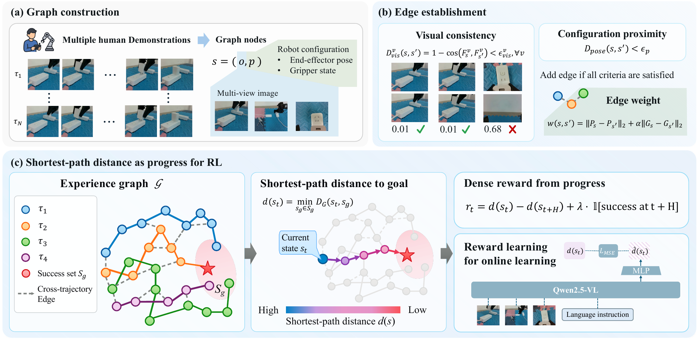
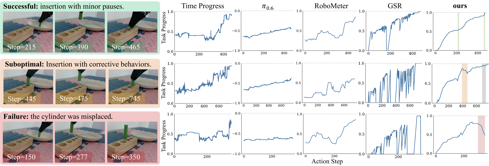

# PRIME

**Not All Actions Contribute Equally: Learning Precise Progress Estimation from Imprecise Demonstrations**

## Overview

PRIME is a task progress estimator for robotic manipulation that learns precise progress estimates from imprecise human demonstrations. Existing approaches often assume that progress increases with time, which can mistakenly reward pauses, errors, and setbacks—especially in high-precision manipulation.

PRIME aggregates experience across demonstrations into a weighted graph, connecting observed states based on spatial proximity and visual consistency. Shortest-path distances to successful states approximate the remaining distance to task completion, allowing PRIME to distinguish meaningful advancement from stagnation and regression. These progress estimates support both dense reward generation for online reinforcement learning and progress-prioritized sampling for offline policy learning.

*PRIME combines demonstrations into an experience graph and uses shortest-path distances to estimate task progress.*

## Results

Experiments in simulation and on real robots demonstrate improved performance across manipulation tasks, including peg-in-hole and charger insertion, under varying demonstration quality. On charger insertion with noisy demonstrations, PRIME achieves a 50% success rate compared with 10% for the supervised fine-tuning baseline.

*PRIME captures advancement, corrective setbacks, and failure across real-world manipulation trajectories.*

## Code Availability

Code will be released upon acceptance.
